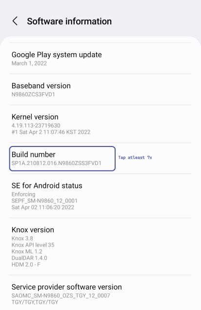
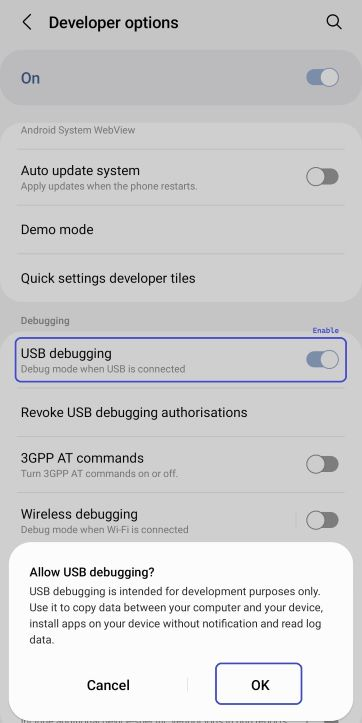
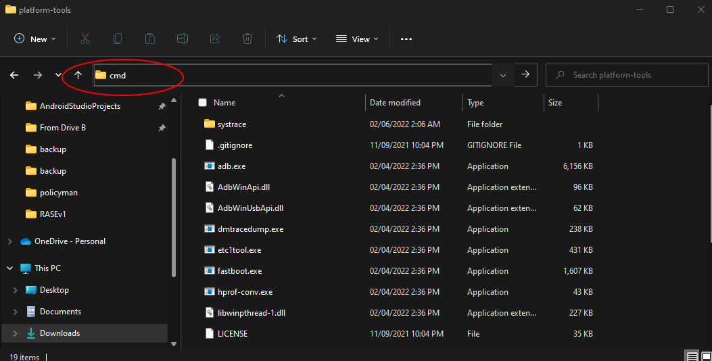
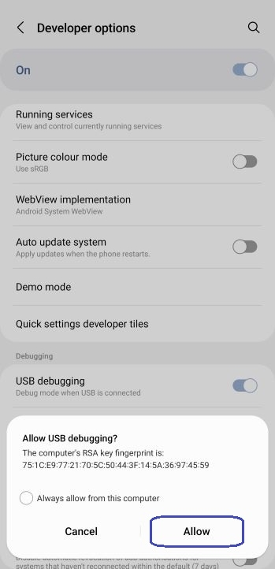
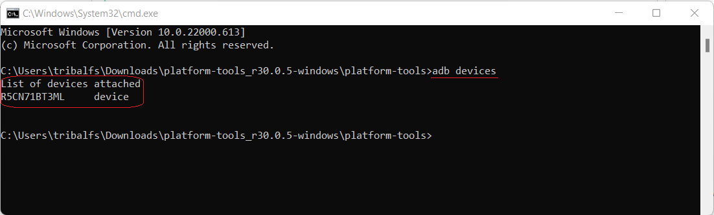
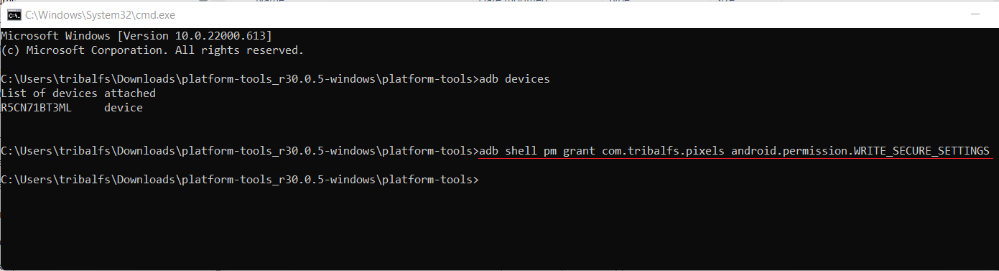

[English](../../README.md) | [Español](../es/README.md) | [Português](README.md) | [हिन्दी](../hi/README.md) | [Bahasa Indonesia](../in/README.md) | [العربية](../ar/README.md)

# Pixels - Alternador Inteligente de Resolução e DPI

* [Google Play Store](https://play.google.com/store/apps/details?id=com.tribalfs.pixels)

Pixels precisa da permissão **WRITE_SECURE_SETTINGS** para funcionar (isso NÃO é root).

----------------------

### TL;DR

* Execute `adb shell pm grant com.tribalfs.pixels android.permission.WRITE_SECURE_SETTINGS`
* Se estiver usando um aplicativo de terminal Android com permissão elevada,
  execute `pm grant com.tribalfs.pixels android.permission.WRITE_SECURE_SETTINGS`

----------------------

Procedimentos ADB usando um PC:
----------------------

### 1. Ative o modo de desenvolvedor nas configurações do telefone

<details>

* Vá para _Configurações_ > _Sobre o telefone_ > _Informações do software_ e toque em _Número da versão_ várias vezes
  até que o modo de desenvolvedor seja ativado.


</details>

### 2. Ative a depuração USB

<details>

* Vá para _Configurações_ > _Opções do desenvolvedor_ (pode ser _Configurações_ > _Sistema_ > _Opções do desenvolvedor_ em
  versões mais antigas do Android), role para baixo e encontre a opção _Depuração USB_.



#### Notas para alguns dispositivos como MIUI:

* Ative também a _Depuração USB para Configurações de Segurança_ se presente na opção de Desenvolvedor.

* Ative a opção _Desativar monitoramento de permissão_ se presente nas Opções do desenvolvedor. É necessário reiniciar.

</details>

### 3. Baixe o ADB no seu computador

<details>

* Baixe o ADB (platform-tools) para o seu computador:
  para [Windows](https://dl.google.com/android/repository/platform-tools-latest-windows.zip) |
  para [Mac](https://dl.google.com/android/repository/platform-tools-latest-darwin.zip) |
  para [Linux](https://dl.google.com/android/repository/platform-tools-latest-linux.zip)

* Extraia o arquivo zip baixado.

</details>

### 4. Navegue para dentro da
pasta `platform-tools` que você extraiu no Windows Explorer ou Finder (macOS)

### 5. Abrindo a interface de linha de comando

  <details>

#### Para Windows: Abra o CMD

* Digite `cmd` na barra de endereço e pressione enter. Isso abrirá o aplicativo do Prompt de Comando do Windows
  .



#### Para MacOS: Abra o Terminal

* Pesquise `Terminal` no Launchpad e execute-o.

* Execute `sudo -s` e digite sua senha de usuário. **O terminal não exibirá quantos caracteres você
  digita, ele permanecerá em branco.**

* Execute `export PATH=.:$PATH`

**Sem isso, você receberá erros `adb: command not found`.**

</details>

### 6. Conectando seu telefone ao seu computador

  <details>

* Seu telefone solicitará _Permitir depuração USB_ se for a primeira vez que for conectado no modo de depuração USB
  . Toque em _Permitir_ ou _OK_.
* Você pode marcar _Sempre permitir deste computador_ (Verifique a nota no final
  deste tutorial sobre como manter a depuração USB ativada).



* Verifique a conexão inserindo o seguinte comando seguido por um enter. Ele deve mostrar o
  ID do seu dispositivo se conectado com sucesso.

> ```adb devices```



#### Para macOS: ```./adb devices ```

* Se o seu dispositivo não conseguir se conectar ao seu computador, tente conectá-lo a uma porta USB diferente e/ou
  usando um cabo de dados USB diferente. Se ainda não conectar, possivelmente seu computador está sem o
  driver USB para o seu telefone.
  Verifique [aqui para baixar os drivers USB OEM](https://developer.android.com/studio/run/oem-usb#Drivers).
  Uma vez instalado, reinicie o seu PC e refaça o passo 6.

</details>

### 7. Concessão real da permissão WRITE_SECURE_SETTINGS para o Pixels

  <details>

* Quando conectado com sucesso, digite o seguinte comando e pressione enter. Você pode copiar o comando
  abaixo. Se o comando for executado corretamente, ele retornará em branco.

> ```adb shell pm grant com.tribalfs.pixels android.permission.WRITE_SECURE_SETTINGS```

* Se ele solicitar `adb.exe: more than one device/emulator...`, execute o seguinte:

>
```adb -s [ID do dispositivo mostrado na etapa 6] shell pm grant com.tribalfs.pixels android.permission.WRITE_SECURE_SETTINGS```



#### Para macOS:

```./adb shell pm grant com.tribalfs.pixels android.permission.WRITE_SECURE_SETTINGS ```

#### Nota para MIUI, OnePlus e alguns outros dispositivos

Se você receber o erro `java.lang.SecurityException: grantRuntimePermission`, siga estas etapas:

1. Vá para _Configurações_ > _Opções do desenvolvedor_ (pode ser _Configurações_ > _Sistema_ > _Opções do desenvolvedor_
2. Role para baixo e ative **Depuração USB (Configurações de segurança)**
3. Se qualquer _Diálogo de Cuidado_ aparecer, siga seus passos para prosseguir.
4. Reinicie seu dispositivo e tente as etapas da Seção 7 novamente.

**É isso!**
</details>

#### Agora você pode desativar as configurações de depuração USB

* **Importante**: Mantenha a depuração USB ativada if you want to try exotic screen resolution(s) on your
  device that may potentially crash the system. _Sempre permitir deste computador_ deve ser verificado
  na etapa 6. Comandos ADB para redefinir a resolução da tela: `adb shell wm size reset`
  e `adb shell wm density reset`.

* Se você não precisar da depuração USB, agora pode desativar as configurações de depuração USB para evitar possíveis
  acessos indesejados.

* Vá para _Configurações_ > _Opções do desenvolvedor_, role uma página para baixo e **desative** a opção _Depuração USB_
.

----------------------
[GUIA EM VÍDEO](https://youtu.be/hKxc8wqanxA)

----------------------


Procedimentos ADB sem usar um PC:
----------------------
<details>

* Você pode instalar o [LADB](https://github.com/tribalfs/LADB/releases), seguir seu guia de configuração e
  executar o seguinte comando:

  `pm grant com.tribalfs.pixels android.permission.WRITE_SECURE_SETTINGS`

  Nota: Isso requer conexão a uma rede wifi. Se tiver um java.lang.SecurityException, verifique as
  notas na etapa 2 acima.

* [PASSO A PASSO EM VÍDEO](https://youtu.be/gdPHB9ru238)

  Importante: LADB às vezes requer algumas tentativas para fazê-lo funcionar e pode não funcionar em todos os
  dispositivos.

</details>


----------------------

### Você não precisa repetir este processo, a menos que desinstale completamente o aplicativo e o reinstale.


